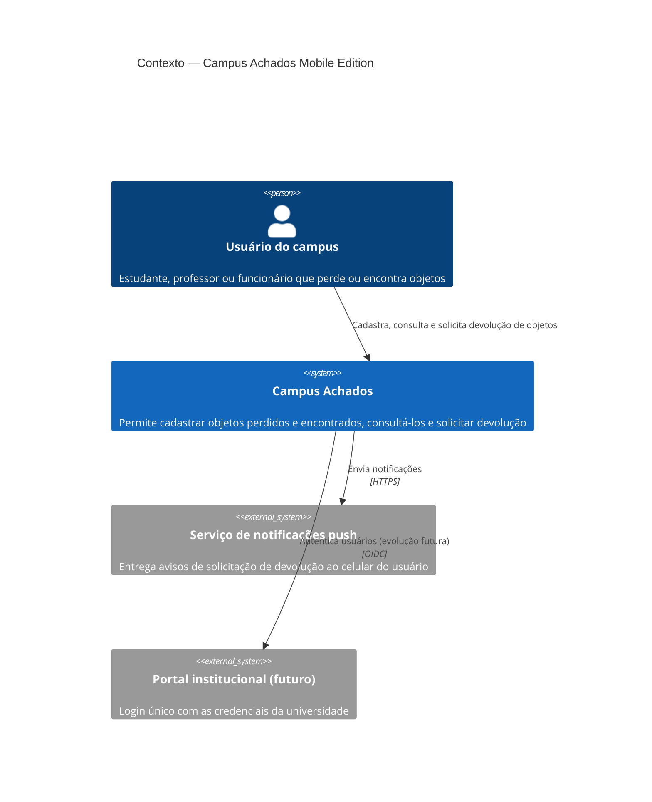
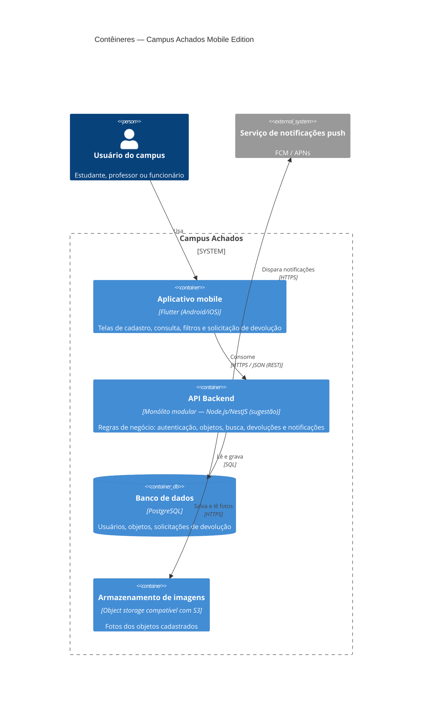

# Arquitetura — Campus Achados Mobile Edition

**Grupo:** Arthur Henrique Souza Barros, Guilherme Pereira dos Santos

Este documento descreve a arquitetura do Campus Achados, aplicativo mobile para registrar, consultar e devolver objetos perdidos e encontrados dentro do campus. As decisões abaixo partem dos requisitos funcionais (cadastro de objeto encontrado/perdido, consulta, pesquisa e filtragem, solicitação de devolução) e dos requisitos não funcionais (escalabilidade, desempenho, disponibilidade) já levantados no backlog.

---

## 1. Atributos de qualidade críticos

| # | Atributo | Por que é crítico neste projeto | Métrica verificável | Como verificar |
|---|---|---|---|---|
| 1 | **Desempenho** | Se a lista demora, o usuário desiste e volta ao WhatsApp. | Listagem e busca com **p95 ≤ 2 s** com 5.000 objetos cadastrados, em rede 4G. | Teste de carga (k6/JMeter) sobre `GET /objetos` com massa de dados de 5.000 itens. |
| 2 | **Disponibilidade** | Quem perde um item precisa consultar a qualquer hora, não só em horário comercial. | **≥ 99% de uptime mensal** (≈ 7 h 12 min de indisponibilidade tolerada por mês de 30 dias). | Health check (`/saude`) monitorado a cada minuto por ferramenta de uptime. |
| 3 | **Escalabilidade** | O uso cresce em picos (início de semestre, provas, eventos). | Suportar de **500 a 5.000 usuários ativos** sem mudar a arquitetura, mantendo p95 ≤ 2 s a **50 req/s**. | Teste de carga progressivo (rampa de 10 a 50 req/s) e comparação com a métrica de desempenho. |
| 4 | **Segurança e privacidade** | O sistema guarda dados de contato e entrega bens pessoais; devolver a pessoa errada é o pior cenário. | **100% dos endpoints** (exceto login/cadastro) exigem autenticação; senhas com hash bcrypt; contato do cadastrante só liberado após aprovação; **0 vulnerabilidades altas/críticas** em varredura OWASP ZAP. | Teste automatizado de acesso sem token (esperado 401) + varredura ZAP no pipeline. |
| 5 | **Usabilidade** | Quem achou um objeto quer largá-lo no sistema rápido, sem fricção. | Cadastro de objeto encontrado concluído em **≤ 60 s** por **≥ 90% dos participantes** de um teste com 5 usuários. | Teste de usabilidade moderado, cronometrando a tarefa. |

> Observação: manutenibilidade foi considerada, mas ficou fora dos cinco mais críticos por ser uma preocupação interna do time, e não algo que o usuário final percebe diretamente.

---

## 2. Diagrama C4 — Nível 1: Contexto

**Leitura:** há um único tipo de ator humano (o usuário do campus), que alterna entre os papéis de "quem achou" e "quem perdeu". O sistema depende de um serviço externo de push para notificar e, numa evolução futura, do portal institucional para login único.

---

## 3. Diagrama C4 — Nível 2: Contêineres

> Os diagramas usam a sintaxe C4 do Mermaid, renderizada nativamente pelo GitHub/GitLab (recurso ainda marcado como experimental). A stack indicada (Flutter, NestJS, PostgreSQL) é uma sugestão e pode ser trocada pela que o grupo dominar, sem alterar o estilo arquitetural.

### Módulos internos da API (monólito modular)

| Módulo | Responsabilidade | Requisito atendido |
|---|---|---|
| Autenticação | Cadastro, login e emissão de token | Base de segurança (todos os cenários "logado no sistema") |
| Objetos | Cadastro de objeto encontrado e perdido, consulta | Cadastro de Objeto Encontrado, Cadastro de Objeto Perdido, Consulta |
| Busca | Pesquisa e filtros por categoria, local, data e palavra-chave | Pesquisa e Filtragem |
| Devoluções | Solicitação, comprovação de posse e aprovação | Solicitação de Devolução |
| Notificações | Envio de avisos de status | Notificações (Could Have) |

Cada módulo tem fronteira própria (pastas, interfaces e tabelas separadas), de modo que possa ser extraído como serviço independente se o projeto crescer.

---

## 4. Estilo arquitetural escolhido

**Cliente-servidor com monólito modular em camadas, exposto por API REST.**

### Justificativa a partir dos atributos

| Atributo | Como o estilo atende |
|---|---|
| Desempenho | Chamadas em processo entre módulos (sem latência de rede interna) e um único banco com índices em categoria, local e data mantêm o p95 dentro de 2 s. |
| Disponibilidade | Poucos componentes para operar significa menos pontos de falha. Pode rodar em 2 instâncias atrás de um balanceador, com banco gerenciado e backup. |
| Escalabilidade | A API é *stateless* (token no cabeçalho, fotos fora do servidor), então escala horizontalmente adicionando instâncias. A meta de 5.000 usuários não exige distribuição por serviços. |
| Segurança | Um único ponto de entrada facilita aplicar autenticação, validação e auditoria de forma uniforme em todos os endpoints. |
| Usabilidade | A API única permite respostas sob medida para as telas do app, reduzindo o número de chamadas e o tempo de carregamento. |

### Por que não algo mais complexo

O time tem duas pessoas, um prazo de semestre e um volume de uso moderado. Microsserviços trariam custo operacional (orquestração, observabilidade distribuída, consistência entre serviços) sem benefício real nessa escala. O detalhamento dessa escolha, com as alternativas descartadas, está no [ADR-0001](adr/0001-estilo-arquitetural-monolito-modular.md).

---

## 5. Registros de decisões arquiteturais (ADRs)

| ADR | Decisão | Status |
|---|---|---|
| [ADR-0001](adr/0001-estilo-arquitetural-monolito-modular.md) | Adotar monólito modular com API REST | Aceito |
| [ADR-0002](adr/0002-banco-de-dados-relacional-postgresql.md) | Usar PostgreSQL como banco de dados principal | Aceito |

---

## 6. Rastreabilidade: atributo, decisão e verificação

| Atributo | Decisão arquitetural | Onde verificar |
|---|---|---|
| Desempenho | Monólito modular + índices no PostgreSQL | Teste de carga p95 ≤ 2 s |
| Disponibilidade | API stateless em múltiplas instâncias + banco gerenciado | Monitor de uptime ≥ 99% |
| Escalabilidade | API stateless + fotos em object storage | Teste de rampa até 50 req/s |
| Segurança | Autenticação central + liberação de contato só após aprovação | Teste de endpoints sem token + OWASP ZAP |
| Usabilidade | API sob medida para o app mobile | Teste de usabilidade com 5 usuários |
